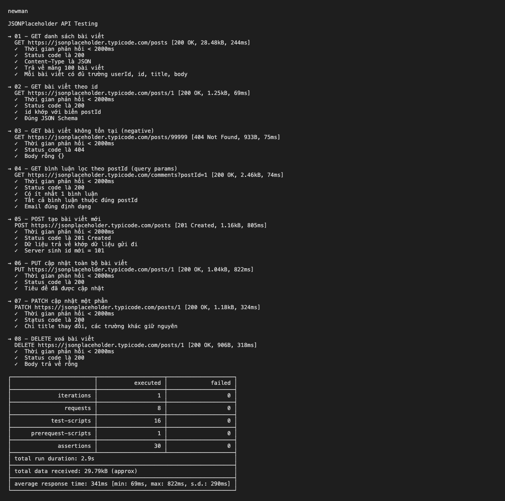
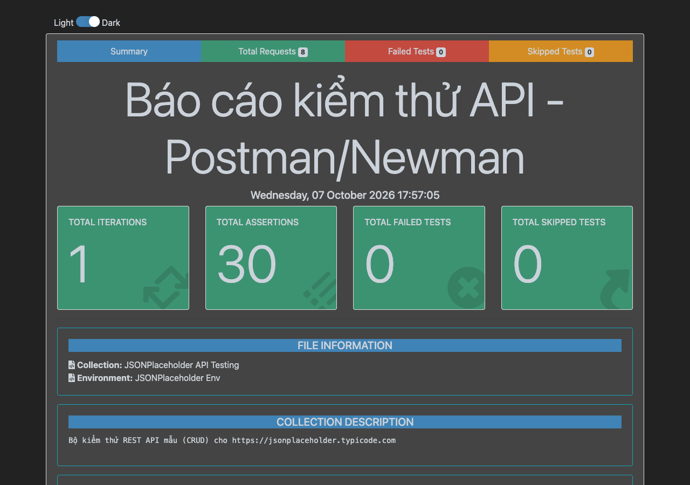
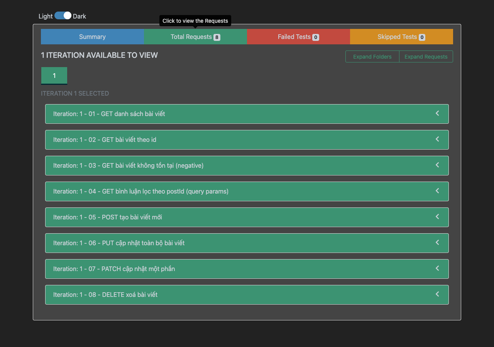
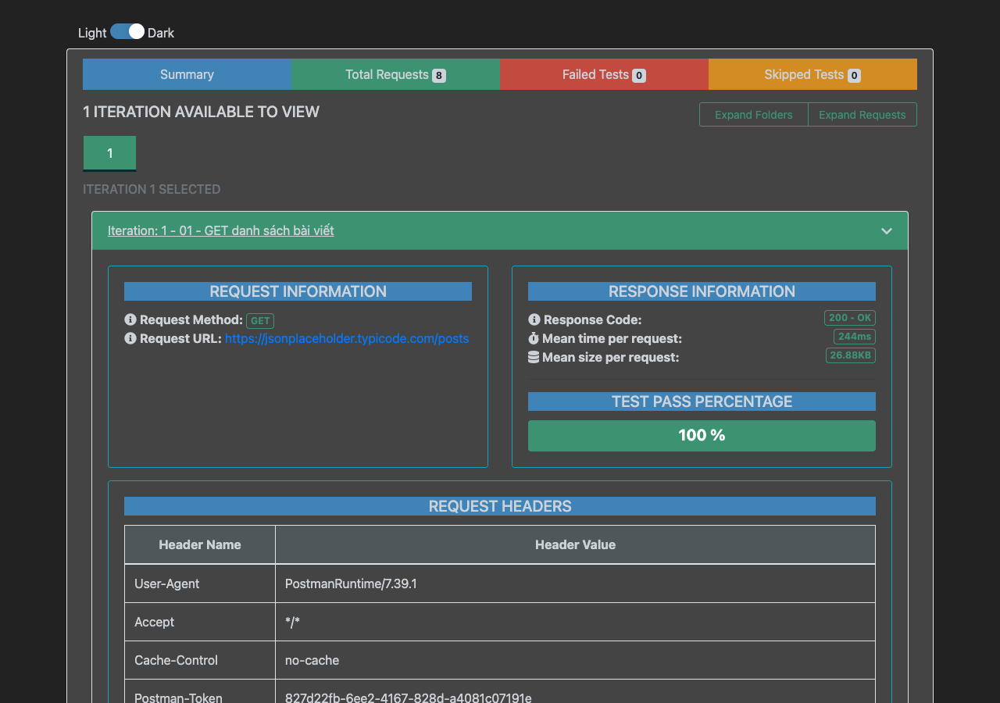

# Kiểm thử API với Postman

| | |
|---|---|
| **Sinh viên** | Trần Đình Danh |
| **Mã sinh viên** | 23010211 |
| **Môn học** | Đánh giá và kiểm định chất lượng phần mềm |
| **Giảng viên hướng dẫn** | TS. Trịnh Thanh Bình |
| **Bài tập** | Lab 7: Kiểm thử API với Postman |

## 1. Mục tiêu

- Tìm hiểu công cụ kiểm thử API **Postman** (theo video [hướng dẫn Postman](https://www.youtube.com/watch?v=MFxk5BZulVU) và tài liệu chính thức [Postman Learning Center](https://learning.postman.com/docs/introduction/overview/)).
- Xây dựng một **Collection** kiểm thử đủ các thao tác CRUD của một REST API, có viết **test script** tự động kiểm tra kết quả.
- Chạy collection tự động bằng **Collection Runner** và bằng dòng lệnh **Newman**, xuất báo cáo HTML.

## 2. Kiến thức Postman đã tìm hiểu

| Khái niệm | Mô tả ngắn |
|---|---|
| **Request** | Một lời gọi HTTP gồm method (GET/POST/PUT/PATCH/DELETE), URL, headers, params, body. |
| **Collection** | Nhóm các request liên quan, có thể chạy tuần tự, chia sẻ và xuất ra file `.json`. |
| **Environment & Variables** | Lưu giá trị dùng lại như `{{baseUrl}}`, `{{postId}}`; đổi môi trường (dev/test/prod) không cần sửa request. |
| **Pre-request Script** | JavaScript chạy **trước** khi gửi request (ví dụ sinh dữ liệu động). |
| **Tests (Post-response Script)** | JavaScript chạy **sau** khi nhận response, dùng `pm.test()` + `pm.expect()` (cú pháp Chai) để kiểm tra kết quả. |
| **Collection Runner** | Chạy toàn bộ collection một lần, xem tổng hợp pass/fail. |
| **Newman** | Công cụ CLI chạy collection Postman, phù hợp tích hợp CI/CD. |

## 3. Đối tượng kiểm thử

API công khai **JSONPlaceholder** – `https://jsonplaceholder.typicode.com` – REST API giả lập cho bài viết (`/posts`) và bình luận (`/comments`).

## 4. Cấu trúc repo

```
├── collection/
│   ├── JSONPlaceholder.postman_collection.json   # Collection (import vào Postman)
│   └── JSONPlaceholder.postman_environment.json  # Environment: baseUrl, postId
├── reports/
│   ├── report.html                # Báo cáo HTML do Newman sinh ra
│   └── newman-cli-output.txt      # Kết quả chạy trên terminal
├── images/                        # Ảnh minh hoạ
└── package.json                   # Script "npm test" chạy Newman
```

## 5. Các test case

Biến môi trường: `baseUrl = https://jsonplaceholder.typicode.com`, `postId = 1`.
Ngoài ra, ở **mức Collection** có 1 test chung áp dụng cho mọi request: *thời gian phản hồi < 2000ms*.

| # | Tên | Method & Endpoint | Kiểm tra (assertions) | Kết quả |
|---|---|---|---|---|
| 01 | Lấy danh sách bài viết | `GET /posts` | Status 200; Content-Type JSON; mảng 100 phần tử; mỗi phần tử đủ `userId, id, title, body` | ✅ Pass |
| 02 | Lấy bài viết theo id | `GET /posts/{{postId}}` | Status 200; `id` khớp biến; đúng **JSON Schema** | ✅ Pass |
| 03 | Bài viết không tồn tại (negative) | `GET /posts/99999` | Status 404; body rỗng `{}` | ✅ Pass |
| 04 | Lọc bình luận theo query param | `GET /comments?postId={{postId}}` | Status 200; có ≥ 1 bình luận; tất cả đúng `postId`; email đúng định dạng (regex) | ✅ Pass |
| 05 | Tạo bài viết | `POST /posts` | Status 201; dữ liệu trả về khớp dữ liệu gửi; id mới = 101; lưu `createdId` vào environment | ✅ Pass |
| 06 | Cập nhật toàn bộ | `PUT /posts/{{postId}}` | Status 200; title đã đổi | ✅ Pass |
| 07 | Cập nhật một phần | `PATCH /posts/{{postId}}` | Status 200; chỉ title đổi, trường khác giữ nguyên | ✅ Pass |
| 08 | Xoá bài viết | `DELETE /posts/{{postId}}` | Status 200; body rỗng | ✅ Pass |

**Tổng: 8 request – 30 assertions – 0 lỗi.**

### Ví dụ test script (request 05 – POST)

Pre-request Script – sinh tiêu đề động:
```js
pm.environment.set('newTitle', 'Postman test ' + Date.now());
```

Tests:
```js
pm.test('Status code là 201 Created', () => pm.response.to.have.status(201));
const p = pm.response.json();
pm.test('Dữ liệu trả về khớp dữ liệu gửi đi', () => {
  pm.expect(p.title).to.eql(pm.environment.get('newTitle'));
  pm.expect(p.userId).to.eql(1);
});
pm.test('Server sinh id mới = 101', () => pm.expect(p.id).to.eql(101));
pm.environment.set('createdId', p.id);   // truyền dữ liệu sang request khác
```

Kiểm tra JSON Schema (request 02):
```js
pm.test('Đúng JSON Schema', () => pm.response.to.have.jsonSchema({
  type: 'object',
  required: ['userId', 'id', 'title', 'body'],
  properties: {
    userId: { type: 'integer' }, id: { type: 'integer' },
    title:  { type: 'string'  }, body: { type: 'string'  }
  }
}));
```

## 6. Thực hiện trên Postman

1. Mở Postman → **Import** → chọn 2 file trong thư mục `collection/`.
2. Chọn environment **JSONPlaceholder Env** ở góc trên bên phải.
3. Mở từng request → **Send** → xem tab **Body** và **Test Results**.
4. Chuột phải vào collection → **Run collection** → **Run** để chạy toàn bộ.

<!-- TODO: chụp màn hình Postman của bạn, lưu vào thư mục images/ với đúng tên dưới đây -->

**Gửi request GET và xem kết quả test:**


**Gửi request POST với body JSON:**


**Chạy toàn bộ collection bằng Collection Runner:**


## 7. Chạy tự động bằng Newman (CLI)

```bash
npm install
npm test
```

Kết quả trên terminal – 8 request, 30 assertions, 0 lỗi:



### Báo cáo HTML (newman-reporter-htmlextra)

Tổng quan – 30 assertions, 0 failed:



Danh sách 8 request đã chạy:



Chi tiết một request – 100% test pass:



## 8. Kết luận

- Đã nắm được cách tạo request, tổ chức collection, dùng biến môi trường, viết pre-request script và test script trong Postman.
- Đã kiểm thử cả trường hợp hợp lệ (positive) lẫn không hợp lệ (negative – 404), kiểm tra status code, header, dữ liệu, JSON Schema, thời gian phản hồi, và truyền dữ liệu giữa các request.
- Dùng Newman để chạy collection từ dòng lệnh và xuất báo cáo HTML – có thể tích hợp vào CI/CD (ví dụ GitHub Actions).
- Lưu ý: JSONPlaceholder là API giả lập, các thao tác POST/PUT/PATCH/DELETE trả về kết quả hợp lệ nhưng **không thực sự thay đổi dữ liệu** trên server.

## Tài liệu tham khảo

- Video hướng dẫn Postman: https://www.youtube.com/watch?v=MFxk5BZulVU
- Postman Learning Center: https://learning.postman.com/docs/
- Viết test trong Postman: https://learning.postman.com/docs/tests-and-scripts/write-scripts/test-scripts/
- Newman: https://github.com/postmanlabs/newman
- JSONPlaceholder: https://jsonplaceholder.typicode.com
